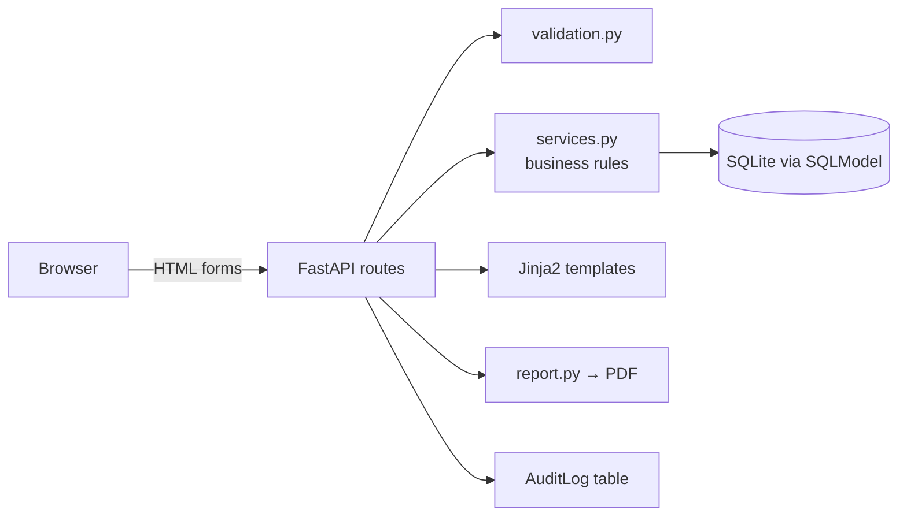

# AssuranceFlow — Cyber Compliance Evidence & Risk Tracker

> **Disclaimer:** This is a fictional learning project. It is not a security assessment,
> compliance certification, or production GRC platform. It contains no real organisation data.
> The company in the sample data, *Fjordkit Digital A/S*, is invented.

AssuranceFlow models the structured work behind cyber assurance: turning a requirement into an owned
control, collecting evidence that the control works, assessing it, raising findings when there is a gap,
and tracking remediation until it is verified — then reporting the status to stakeholders.

```
Requirement → Control → Evidence → Assessment → Finding → Remediation action → Status report
```

## Features
| Area | What it does |
|---|---|
| Requirements register | Fictional requirements with category, owner and review frequency |
| Control register | Controls linked to requirements, each with a named owner |
| Evidence register | Text references (e.g. `AUDIT-2026-014`) with collection and review dates; stale evidence is flagged |
| Assessments | Effective / Partially Effective / Not Effective / Not Tested. *Not Effective* **must** raise a finding |
| Findings tracker | Risk rating, owner, due date, status; overdue findings highlighted |
| Remediation actions | Owner, target date, status; *Verified* requires verification notes; a finding cannot close until all actions are verified |
| Dashboard | Missing evidence, stale evidence, open and High/Critical findings, overdue actions, status by category |
| PDF report | Monthly assurance summary for stakeholders (`/report.pdf`) |
| Audit log | Every create/update is recorded (`/audit-log`) |

## Tech stack
Python 3.12 · FastAPI · SQLModel · SQLite · Jinja2 · HTML/CSS · fpdf2 · pytest

## Run it locally (Windows PowerShell)
```powershell
git clone https://github.com/Rafia180/assuranceflow-evidence-risk-tracker.git
cd assuranceflow-evidence-risk-tracker
python -m venv .venv
.\.venv\Scripts\Activate.ps1
pip install -r requirements.txt
uvicorn app.main:app --reload
```
Open http://127.0.0.1:8000. Sample data loads automatically on first start.
To reset the data, stop the server and delete `assuranceflow.db`.

macOS/Linux: use `source .venv/bin/activate` instead of the Activate line.

## Run the tests
```powershell
pytest -v
```
Tests use a separate in-memory database, so they never change your data.

## Project structure
```
app/
  main.py          app start-up, routers, seed data
  database.py      SQLite engine + session dependency
  models.py        SQLModel tables and enums
  validation.py    form validation helpers
  services.py      business rules: overdue logic, dashboard numbers, audit log
  report.py        PDF status report
  seed.py          fictional sample data
  routes/          registers.py, assurance.py, dashboard.py
  templates/       Jinja2 HTML pages
  static/style.css
tests/             pytest tests
docs/              screenshots and architecture diagram
```

## Architecture


## Design decisions
- **Evidence is stored as a reference, not a file.** Real evidence lives in controlled repositories; the tracker only needs to know *what*, *who*, *when* and *where*.
- **Rules live in `services.py`, not in templates,** so they can be tested on their own.
- **Validation is on the server.** The browser form is never trusted.

## What I would add next
Login and role-based access (assessor vs. control owner), CSV export, mapping requirements to a public framework such as ISO 27001 Annex A or NIST CSF, and evidence-expiry email reminders.
